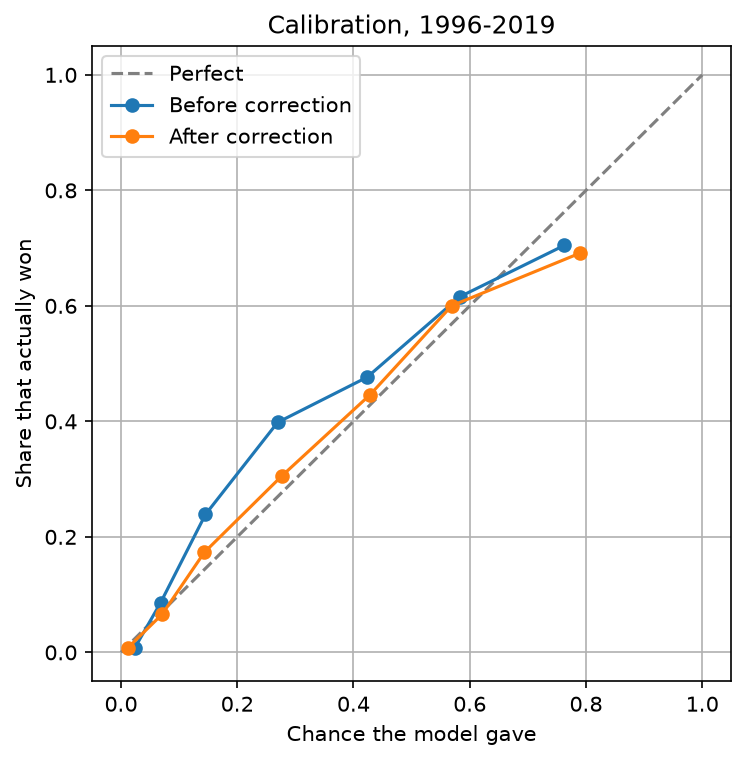
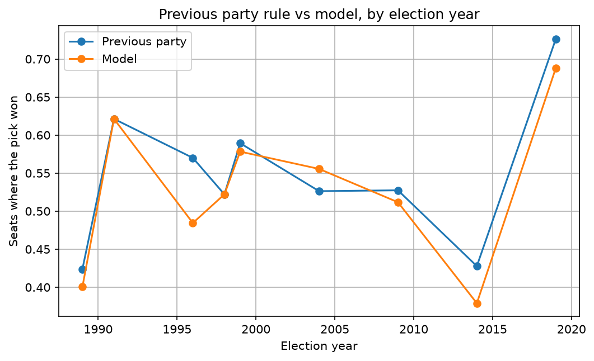

# Winning-chance model for Lok Sabha candidates (1962-2019)

## Goal
Estimate a candidate's chance of winning a seat, using only information
available before the election. The model works for any candidate and any
party, because it uses no party names.

## Data
Lok Sabha candidate-level results, 91,669 rows and 45 columns. The column
names match the Trivedi Centre for Political Data format. [Cite the exact
source with your professor.] By-elections were excluded, leaving 15 general
elections (1962-2019). NOTA entries (1,087 rows) were removed because they
are not candidates.

## Method
- One row per candidate per seat per election (79,881 rows after requiring
  an earlier election for the seat).
- Inputs, all from earlier elections: the person's past contests, past wins
  and whether they are the sitting MP; whether their party held the seat last
  time, for how long, and its vote share there; the party's share of seats
  last election nationally and in the state; the seat's last margin, number
  of candidates and whether it is reserved.
- Columns that already contain the current result (for example No_Terms) were
  left out, to avoid leakage.
- Model: logistic regression on 11 inputs, followed by isotonic recalibration
  learned from all earlier elections' predictions.
- Testing: walk-forward. For each election from 1989 to 2019, train only on
  earlier elections, test on that one.

## Results
Picking the winner (share of seats, average of 9 test years, about 510 seats
per year):

| Strategy | Seats where the pick won |
|---|---|
| Random candidate | 10.4% |
| Party that held the seat last time | 54.8% |
| Sitting MP, else previous party | 54.1% |
| Model | 52.7% |

The model does not beat the simple rule at picking winners. With about 500
seats per year, differences below roughly 4 points could be chance.

Quality of the probabilities (log loss on the winner, lower is better,
average over 9 years): equal chance for everyone 2.447, simple rule 1.911,
model 1.447. The model gives the real winner more probability than the rule
in every test year.

Recalibration (test years 1996-2019): log loss 1.380 before, 1.249 after,
better in all 7 years. Before correction, candidates given about 14% won
24% of the time and those given about 27% won 40%. After correction these
are within about 3 points.

## Limits
- National swings (for example 1996 and 2014) cannot be seen in past data and
  are the main reason winner-picking stops near 55%.
- The model was weakest in 1989, when many seats flipped. The calibration test
  starts in 1996, so it does not show how recalibration behaves in 1989.
- Probabilities above about 70% run high (about 79% predicted, 69% actual).
- Seats with no earlier election (for example after the 2008 boundary
  changes) have no seat history. Party names also change over time, so some
  "changes of party" are renamings.
- The same person can appear under two IDs, so some histories are undercounted.
- Data ends at 2019. The chance shown means "a candidate like this, in a
  typical field in this seat", because rivals are unknown in advance.

## How to run
1. `pip install -r requirements.txt`
2. `python clean.py`
3. `python features3.py`
4. `python final_model.py`
5. `python results.py`